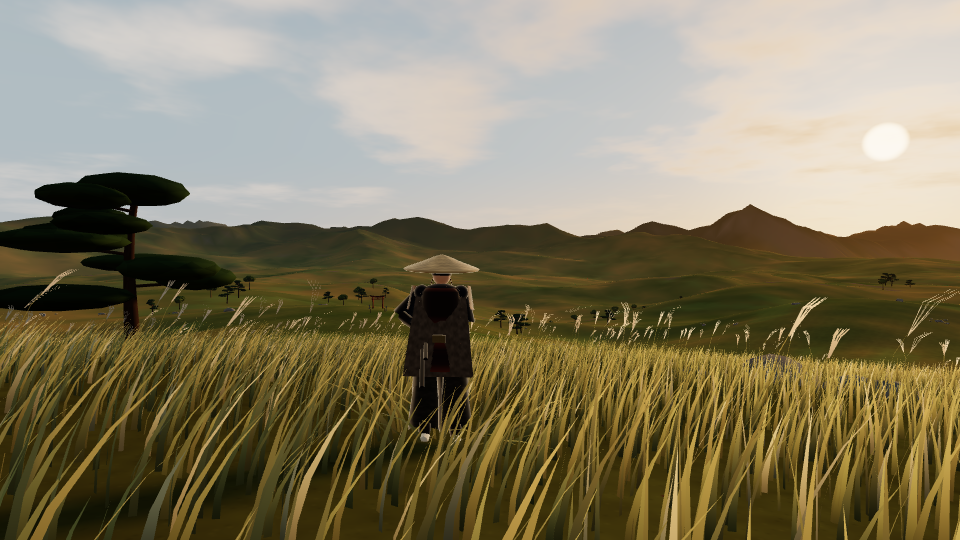

# SAMURAI: The Endless Plains

A third-person samurai exploration game that runs in a desktop web browser. Wander a vast, wind-swept golden grassland at sunset: rolling hills, tall grass and pampas plumes moving in coordinated gusts, windswept pines, hilltop shrines with torii gates and stone lanterns, and layered mountain ranges fading into the haze.

There's no combat and there are no quests. You walk, run, jump and look around.

Built with **Three.js (WebGL)** and the **Web Audio API**. Everything (terrain, grass, rocks, trees, the samurai, his animation, the sky and the ambient sound) is generated procedurally in code. No external assets are needed.



## Running the game on Windows

You need **Node.js 22.12 or newer** (the LTS installer from https://nodejs.org is fine) and an up-to-date **Chrome or Edge** with hardware acceleration enabled.

### Option A: double-click

1. Download or clone this folder.
2. Double-click **`start-game.bat`**.
   - The first run installs dependencies (`npm install`), which takes a minute.
   - It then starts the local server and opens `http://localhost:5173` in your default browser.
3. Keep the console window open while you play. Close it (or press `Ctrl+C`) to stop the server.

### Option B: command line

Open **Command Prompt** or **PowerShell** in the project folder:

```bat
npm install
npm start
```

`npm start` opens the browser automatically. `npm run dev` starts the server without opening a browser; then go to **http://localhost:5173**.

> Opening `index.html` directly from disk (`file://`) is **not supported**. The game uses JavaScript modules that must be served by the local server.

### Production build (optional)

```bat
npm run build
npm run preview
```

This serves the optimised build from `dist/` at **http://localhost:4173**.

## Controls

| Input | Action |
|---|---|
| **W A S D** (or arrow keys) | Move (relative to the camera) |
| **Mouse** | Look around (click the game to capture the mouse) |
| **Shift** | Sprint |
| **Space** | Jump |
| **Mouse wheel** | Camera distance |
| **Esc** (or **P**) | Pause / release the mouse; press again to resume |
| **R** | Return to the starting position |
| **F** | Toggle fullscreen |

The pause menu has **Resume**, **Return to Start**, **Toggle Fullscreen**, **Graphics quality** (Low / Medium / High / Ultra), **Ambient volume**, **Mouse sensitivity**, **Camera distance**, **Invert vertical look**, **Adaptive resolution** and **Show frame rate**. Settings are saved in the browser.

Sound starts when you press **Start Exploring**, as browsers require.

## Graphics settings

| Preset | Shadows | Grass radius / density | Post-processing | Notes |
|---|---|---|---|---|
| Low | off | 48 m / 32% | off | 0.75× render scale, for integrated graphics |
| Medium | 1024² | 70 m / 55% | off | default on most machines |
| High | 2048² | 96 m / 80% | bloom + grade | dedicated GPUs |
| Ultra | 4096² | 120 m / 100% | bloom + grade | 1.5× render scale, strong GPUs |

On the first run a preset is picked from the GPU name. **Adaptive resolution** (on by default) lowers the render scale when the frame rate stays under ~40 fps, and raises it again when there is headroom.

## Project layout

```
index.html            UI markup (loading, title, pause menu, HUD)
start-game.bat        Windows launcher
src/
  main.js             entry point
  game.js             renderer, state machine, main loop, settings application
  world.js            analytic terrain height, paths, clearings, biome masks
  noise.js            seeded simplex noise and hashes
  terrain.js          streaming quadtree LOD terrain
  grass.js            instanced wind-animated grass and pampas plumes
  props.js            rocks, pebbles, trees, shrines (placement, streaming, colliders)
  prop-geometry.js    procedural rock / tree / torii / lantern meshes
  mountains.js        distant layered mountain rings
  atmosphere.js       sun, height fog, sky dome
  lighting.js         sun + ambient lights, shadow frustum
  character.js        procedural samurai model and cloak
  animation.js        procedural animation, IK, cloak dynamics
  player.js           player = physics body + model + animation
  movement.js         movement physics (pure, unit tested)
  collision.js        spatial-hash colliders (pure, unit tested)
  camera.js           third-person camera rig (unit tested)
  input.js            keyboard / mouse / pointer lock
  audio.js            procedural Web Audio ambience
  ui.js               DOM UI wiring
  settings.js         quality presets and saved settings
  postfx.js           bloom and colour grading
  textures.js         procedural textures
tests/
  movement.test.js, collision.test.js, camera.test.js, world.test.js
  e2e/browser-check.mjs   automated in-browser checks (Playwright)
  e2e/screenshot.mjs      screenshot capture helper
docs/
  reference-analysis.md   visual direction and what references were (not) available
  asset-inventory.md      assets found, procedural replacements, limitations
  testing-report.md       actual test results
```

## Tests

```bat
npm test               rem unit tests (Vitest)
npm run test:browser   rem automated browser checks; needs a Playwright Chromium (npx playwright install chromium)
```

See [docs/testing-report.md](docs/testing-report.md) for what was tested and how.
